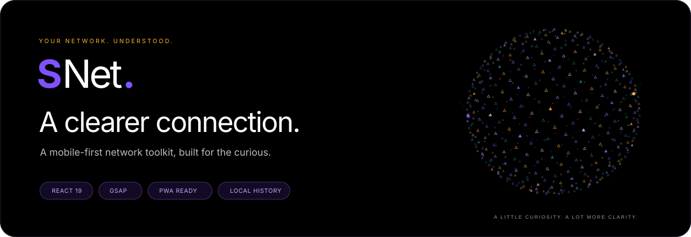
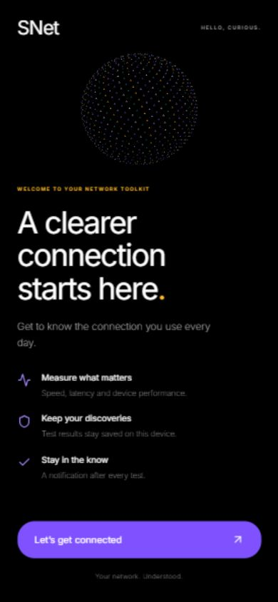
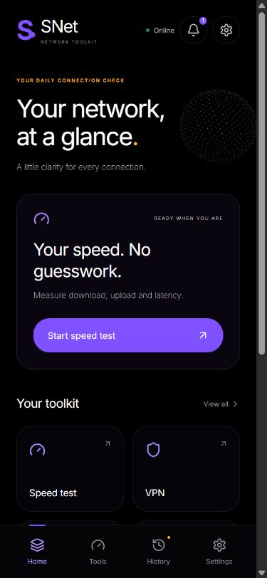
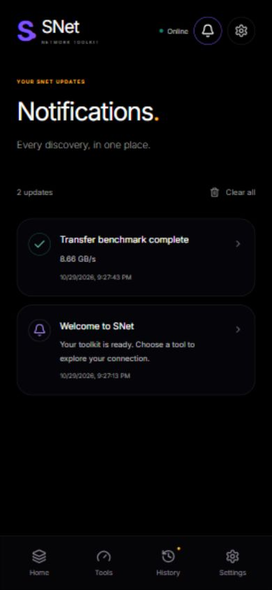
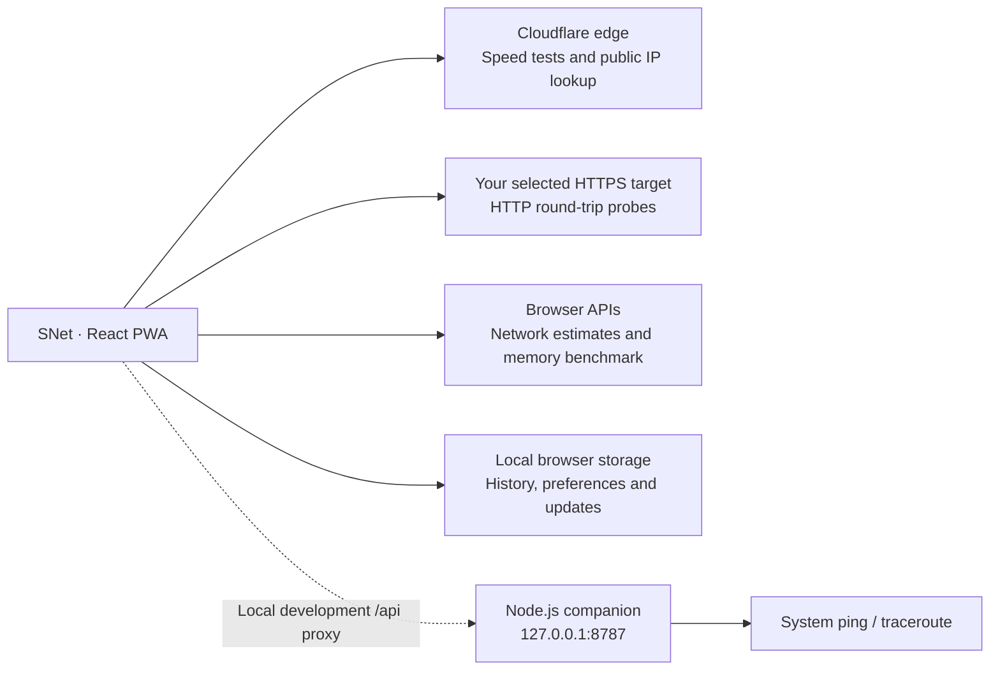

<a id="top"></a>

<div align="center">



**Measure your speed. Follow your data. Understand your connection.**

A mobile-first React PWA with real measurements, a GSAP particle globe, and a little curiosity built in.

[Explore the app](https://snet-network-toolkit-r9k4.hrjomkumpul.chatgpt.site) · [Quick start](#quick-start) · [Deploy to Cloudflare](#deploy-to-cloudflare-pages) · [How it works](#how-it-works)

<sub>The hosted demo is private and requires ChatGPT sign-in. Local development does not require an account.</sub>

</div>

---

## A closer look

<p align="center">
  
  
  
</p>

<p align="center"><sub>Welcome → Explore → Stay informed. Screenshots show the actual app; measured values vary by device and connection.</sub></p>

## Your connection, from every angle

| Tool | What you can do | Where it runs |
| :--- | :--- | :--- |
| **Speed test** | Measure download, upload, and HTTP latency against Cloudflare’s edge. Choose duration and direction, watch the live chart, or stop a test. | Browser |
| **Ping** | Inspect HTTP round-trip averages, minimum, maximum, jitter, and failed probes. Switch to real ICMP through the companion. | Browser / local companion |
| **Traceroute** | Run your system’s route-tracing command and inspect its output. | Local companion |
| **Network information** | Look up public IP and Cloudflare edge details; view connection estimates when the browser exposes them. | Browser |
| **Transfer benchmark** | Measure actual typed-array memory-copy throughput on your device. | Browser |
| **VPN setup** | Follow native VPN setup guidance, then inspect your public connection. | External native VPN app |

### More than a set of tests

- **An app-shaped experience.** A single-column shell, two-column tool launcher, sticky header, and safe-area-aware bottom navigation. On larger screens, the app stays centered at a maximum width of 480px.
- **A thoughtful first launch.** A lightweight pre-JavaScript loader, branded splash, and one-time welcome screen. Replay the welcome screen from Settings.
- **A little motion.** GSAP powers the rotating particle globe, staggered screen entrances, tab feedback, button presses, and result reveals. The globe pauses off-screen and in hidden tabs; reduced-motion preferences are respected.
- **Updates that stay useful.** Welcome messages and successful, failed, or stopped test notifications appear in an in-app banner and a saved inbox. Result notifications link to the matching saved test.
- **Your discoveries, saved.** Keep up to 100 completed tests, export them as JSON, and revisit up to 50 notification updates on the same browser.
- **Ready to install.** PWA manifest, app icons, standalone display, and production asset precaching. The app shell and saved records remain available offline after a successful production load.

## Quick start

**You’ll need:** Node.js **22.12 or newer** and npm.

From the project directory:

```sh
npm ci
npm run dev
```

Open **http://127.0.0.1:5173**.

### Enable real ICMP ping and traceroute

Keep the development server running. In a second terminal:

```sh
npm run companion
```

The companion listens on **127.0.0.1:8787**. Vite forwards local `/api` requests to it, and the companion runs the operating system’s network commands. On systems without a `traceroute` executable, that command must be installed separately; Windows uses `tracert`.

The companion validates target hostnames and applies command timeouts. It is intended for local use and should remain bound to loopback.

## Build, preview, install

```sh
npm run build
npm run preview
```

Open **http://127.0.0.1:4173** to inspect the production build.

The build writes the deployable app to `dist/` and automatically generates the service worker’s asset precache. Serve the app over **HTTPS**, or use localhost during development.

To install, use **Settings → Install app**, or your browser’s **Install app / Add to Home Screen** action. Availability depends on the browser and device.

> Offline support is enabled in production builds. Network measurements still require a connection, and the production preview does not provide Vite’s development-only companion proxy.

## Deploy to Cloudflare Pages

SNet’s browser app is a static Vite build and can be deployed to Cloudflare Pages.

| Build setting | Value |
| :--- | :--- |
| Framework preset | React / Vite |
| Root directory | Project root |
| Build command | `npm run build` |
| Output directory | `dist` |
| Node.js | A compatible version, 22.12+ |

Choose either:

1. **Git integration:** connect your source repository and apply the settings above.
2. **Direct Upload:** run `npm run build` locally, then upload the generated `dist` folder.

See Cloudflare’s [React deployment guide](https://developers.cloudflare.com/pages/framework-guides/deploy-a-react-site/) and [Direct Upload guide](https://developers.cloudflare.com/pages/get-started/direct-upload/).

**Deployment boundary:** the static build includes the browser tools, PWA, animations, onboarding, history, and in-app notifications. `server.mjs` is a separate local companion; deploying `dist/` does not enable native ICMP, traceroute, or a device VPN tunnel.

## How it works



### A few useful distinctions

| Measurement | What it means |
| :--- | :--- |
| **Speed** | Transfer performance from this browser to Cloudflare’s edge, including browser overhead. It is not a guarantee of speed to every service. |
| **HTTP latency** | Request round-trip timing, including HTTPS and browser overhead. It is different from ICMP ping. |
| **Memory throughput** | Typed-array copying inside the browser. It does not measure disk or internet speed. |
| **Network estimates** | Values exposed by the browser, which may be rounded or unavailable. |
| **VPN status** | SNet cannot create or verify a device VPN tunnel. Use your provider’s native app; an IP change alone is not proof of full protection. |

Test durations are approximate and depend on in-flight requests. Speed tests transfer real data, so longer runs can use substantial bandwidth. HTTP targets and external services may reject or block probes.

## Privacy & notifications

SNet has **no app account system or analytics**. Completed results, preferences, onboarding state, and notification history are stored in the browser’s local storage. They do not sync across devices and can be lost if browser data is cleared.

- Speed tests and public-IP lookups contact Cloudflare.
- HTTP probes contact the address you enter.
- The Inter fallback font is requested from Google Fonts; local system fonts remain available as fallbacks.
- Notifications are **in-app updates**, not background push notifications. They do not request browser notification permission.
- Browser apps do not expose gateway, subnet, DNS-server, carrier, or iCloud Private Relay details to this implementation.

## Project map

```text
SNETWork/
├── docs/images/           # README banner and app screenshots
├── public/               # PWA icons, manifest, service-worker template
├── scripts/precache.mjs  # Adds production assets to the offline precache
├── src/
│   ├── main.jsx          # Tools, navigation, history and notifications
│   ├── LaunchScreen.jsx  # Splash and first-launch welcome
│   ├── motion.jsx        # Scoped GSAP motion and canvas particle globe
│   ├── style.css         # Mobile app layout and component styles
│   └── tokens.css        # Color, type, spacing and radius tokens
├── index.html            # App entry and pre-JavaScript loader
├── server.mjs            # Optional local network companion
├── server.test.mjs       # Host-validation checks
├── vite.config.js        # Vite configuration and local API proxy
└── package.json
```

### Everyday commands

| Command | Purpose |
| :--- | :--- |
| `npm run dev` | Start the local development app. |
| `npm run companion` | Enable local ICMP ping and traceroute. |
| `npm run build` | Build the app and generate its offline precache. |
| `npm run preview` | Preview the production build. |
| `npm test` | Run the network target-validation tests. |

## The visual language

**Void black. Electric iris. Saffron sparks.**

SNet uses a 6px spacing scale, 24px rounded controls, lightweight typography, and a procedural particle globe. The preferred font family is PPNeueMontreal, with Inter and system fallbacks; a proprietary PPNeueMontreal font file is not bundled.

| Void | Electric iris | Saffron spark | Deep verdant |
| :---: | :---: | :---: | :---: |
| `#000000` | `#8052ff` | `#ffb829` | `#15846e` |

---

<div align="center">

**SNet** · A little curiosity. A clearer connection.

[Back to top](#top)

</div>
